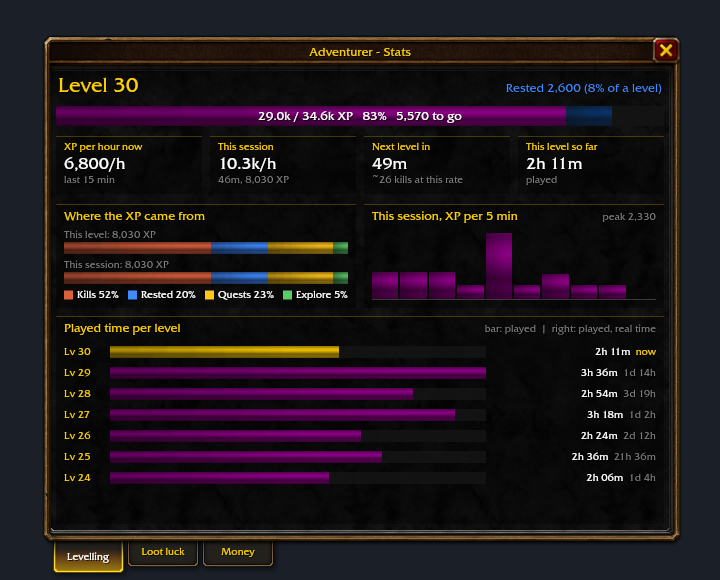
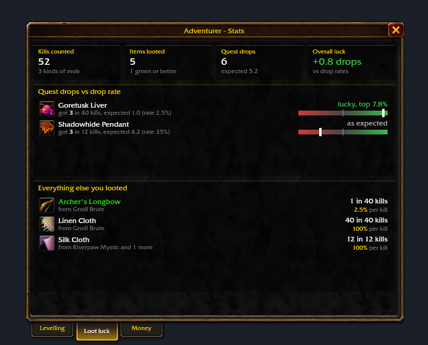
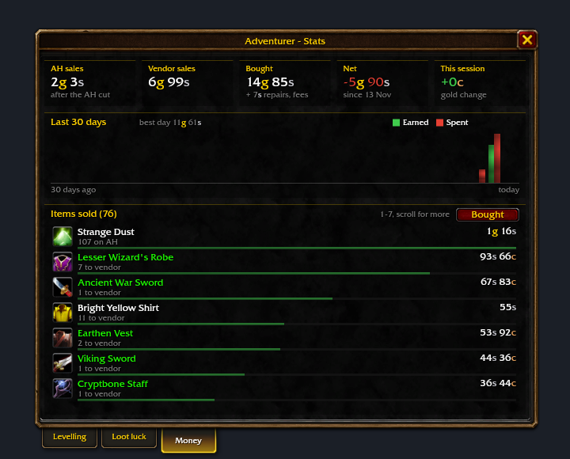

# MeioStats

A stats window for **WoW Forever**: how long each level took and how fast you're levelling
now, whether your quest drops are lucky or unlucky against their real drop rate, and what
you've earned and spent per item.

## What it does

`/stats` opens a window with three tabs.

**Levelling**

- Your XP bar with rested XP, and the XP per hour over the last 15 minutes and over the
  whole session.
- Time to the next level at that rate, and roughly how many kills it is at this level's
  average kill XP.
- Where your XP came from (kills, rested bonus, quests, exploration), for this level and for
  this session, and a chart of XP per 5 minutes this session.
- Played time per level, and the real time from ding to ding, from the level the addon was
  installed at onwards. Played time is exact: it comes from `/played`, which the addon asks
  for quietly at login and on each level up.

**Loot luck**

- Counts your kills per kind of mob and what each corpse dropped.
- For quest items with a known drop rate (from Questie's database), compares the drops you
  got with what that rate predicts, and says how lucky you were: "lucky, top 7.8%" means
  only 7.8% of players with your kills would have seen this many drops or more. Kills only
  count towards an item while its quest is in your log, since quest items don't drop
  otherwise.
- Everything else you've looted, with the rate you've seen per kill.

**Money**

- Auction and vendor sales (after the AH cut), purchases, repairs and fees, and the net,
  from TradeSkillMaster's accounting for every character on your realm.
- Earned against spent per day over the last 30 days.
- Every item you've sold, by revenue, with the profit against what you paid for it (or, with
  Meionomics, against today's cost of its materials); and what you've bought and never sold.
- Gold gained or lost this session.

## Commands

| Command | |
|---|---|
| `/stats` | Open or close the window |
| `/stats level` (or `xp`) | Open on the Levelling tab |
| `/stats loot` (or `luck`) | Open on the Loot luck tab |
| `/stats money` (or `gold`) | Open on the Money tab |
| `/stats help` | List the commands |

`/meiostats` works too, if another addon already uses `/stats`.

## Install

Download this repository (green **Code** button, **Download ZIP**), and copy the
`addons\MeioStats` folder into `World of Warcraft\_forever_\Interface\AddOns`, so that
you end up with `AddOns\MeioStats\MeioStats.toc`. Restart WoW fully (a `/reload` doesn't
find new addons).

Optional, each adds a tab's data:

- [Questie](https://www.curseforge.com/wow/addons/questie): drop rates for the Loot luck
  tab. Without it, kills and loot are still counted.
- [TradeSkillMaster](https://tradeskillmaster.com): its accounting is the Money tab's
  source. Without it, only this session's gold change shows.
- [Meionomics](https://github.com/MeioNeiz/Meionomics): profit for crafted items you sell,
  against the cost of their materials. Meionomics also shows this addon's per-item totals in
  its tooltips.

## Limits

- Levelling and loot are recorded per character from the moment the addon is installed;
  nothing earlier is known, so the first level shows played time only.
- WoW Forever has no combat log for addons, so a kill is counted from its XP message or from
  looting the corpse. Mobs that give no XP and aren't looted are missed.
- Drop rates only exist for quest items in Questie's database.
- TradeSkillMaster saves its ledger when you log out, so the Money tab shows sales up to the
  start of this session.

## Licence

[MIT](LICENSE)
